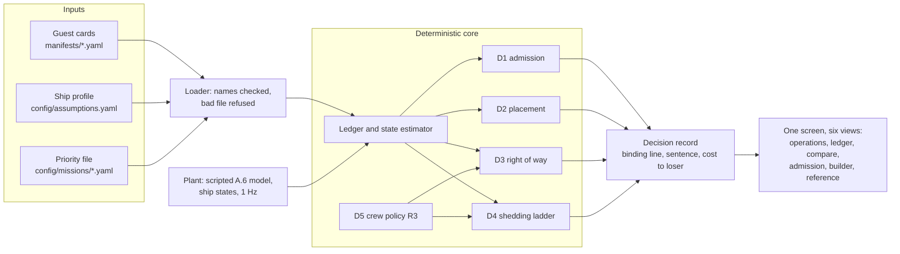

# ArgOS: a resource governor for a re-configurable vessel

Team entry for Fincantieri's **Software Defined Vessel** challenge (Maritime Dual-Use Hackathon, San
Francisco, 16-18 Oct 2026). ArgOS, after the Argo, is the operating system the ship does not have: it owns
the hull's finite physical budget and decides, in seconds and in one plain sentence, which payloads come
aboard, where they go, who wins when two want the same thing, and what is shed when a generator trips.

> **Status (Sat 23:36 PDT): the engine (D1 to D5, the 200 ms safety table, estimator, tick loop, replay) and the screen
> run end to end with `uv run sdv demo`; 1457 tests pass. The plant is a scripted A.6 model, not a physics simulator.**

## Run it

Python 3.12 via uv: `uv sync` once on Wi-Fi, then everything runs offline; `uv run pytest` runs the 1457 tests.

```bash
uv sync && uv run pytest
uv run sdv admit G4 --installed G1,G2,G3 --mission survey
uv run sdv admit G4 --installed G1,G2,G3 --set G4.hangar.mass_t=0.8
uv run sdv admit G4 --installed G1,G2,G3 --set G4.consumes.power_kw.peak=50
uv run sdv run --mission sar --log-dir runs/b-sar && uv run sdv replay runs/b-sar --mission sar
uv run sdv demo
```

`sdv admit` runs D1 and D2 on the real engine: verdict, binding line, every ledger line, placement, ranked yes-if
options and the one-genset-down check, timed against the 30 s ceiling. `--set` is the jury's edit: any number on any
card, re-validated; an edit that cannot be applied or fails the schema is refused with the field named and the previous
card kept. `sdv run` plays Scenario B through the tick loop and prints each decision's sentence; `sdv replay` re-runs
the logs without the simulator and checks every snapshot and record byte for byte. `sdv demo` is the one demo command:
the engine and the screen on http://127.0.0.1:8000 (open it in a browser; `--port 8010` if 8000 is busy), Scenario B
live at x12 with six views (Operations, constraint ledger, Mission compare, Admission review with the jury's edits of
part masses and nominal or peak kW, the profile and rule builder, Reference), a SIM bar (hold, pace, jump to minute 8,
12 or 19, restart, swap the priority file) and a crew chip (14, 6, 0 aboard). Every run the screen shows is logged
under `--log-dir` (default `runs/live`); the terminal prints `RUN n under <file>.yaml logs to <dir>; replay: uv run sdv
replay <dir> --mission <file>` per run and on Ctrl+C.

## Architecture

**One ledger, one manifest language.** Everything that uses or supplies a resource is described the same way and
counted in one ledger of margins across the brief's eight classes: power, heat rejection, deck positions, mast
positions, mass and stability, data links, compute and response time. Every decision names the ledger line that bound
it. Host commitments are never shed; guests are admitted, placed, throttled or shed; supply can degrade; crew are both
hands and authority.



Everything in the diagram runs. Card conditions are typed: every signal, position and capability name is checked
against the ship profile, and an unknown name refuses the file (`src/sdv/loader.py`). Faults enter only as debounced,
confirmed plant signals, a genset trip on 2 of 3 signals, a pump fault on the alarm plus flow or delta-T
(`src/sdv/estimator.py`); while a feed behind an over-commitment is stale the ladder stays armed and the record says
so. Safety commands (stop, hold, secure; 200 ms, A.8) are answered from a table the core rebuilds every tick
(`src/sdv/safety.py`), never by a solver. A replay of the frame and input logs reproduces every snapshot and record byte
for byte; wall-clock latency goes to a separate timing log. Data contracts: [docs/ARCHITECTURE.md](docs/ARCHITECTURE.md).
**Prior art:** a power management system trips non-essential consumers in a fixed preferential-trip order when a
generator is lost; ArgOS is that ladder made mission-aware and explainable: the order follows the active mission,
throttling comes before tripping, and every step names the line that bound it.

## Decision classes

Components live in `src/sdv/`. D1 to D4 read one ledger (`ledger.py`); D1 to D5 write the same
[decision record](docs/ARCHITECTURE.md#data-contracts) (`config/decision_record.schema.json`), and every sentence is
built from the record's fields (`explain.py`, guarded by tests); ceilings are the brief's (A.8).

| Class (ceiling) | Component | What it optimises |
|---|---|---|
| D1 Admission (30 s) | `admission.py` | Yes, yes-if or no in the mission envelope (rule below); the binding line is the most-over line, else the tightest of mass, stability, power, heat, the two mission lines, the three data links and compute; for yes-if, the minimal removal sets ranked by mission value lost, mission-critical last |
| D2 Placement (30 s) | `placement.py` | Lexicographic, by enumeration of every allowed layout: no installed part left without a position, most parts placed, fewest port moves, preferred positions first, then a fixed order; no margin term, no rejected-alternatives record (CON-18) |
| D3 Right of way (2 s) | `arbitration.py` | Opens when G4's active hard limit (below 20 %: land within 12 min) meets G3's survey leg, on the two cards' typed ship-state conflicts; the priority file decides how G3 yields (pause and resume, or abort open-ended) and whether G4's charge is reserved; cost to G3 in survey minutes |
| D4 Degradation (5 s, 60 s) | `shedding.py` | By [response class](docs/RESPONSE_TIME.md): 200 MS never shed, 5 S first, 60 S mission-critical one step a second; throttle before shed in each class, then `shed_order`, then least mission loss per kW; ladder precomputed every tick |
| D5 Crew as a setting | `core.py` (`_r3_policy`) | Per crew level (14, 6, 0), from `rules.r3` in the ship profile: confirm, standing plan, automatic or forbidden; a priority file may override a level, never to confirm at 0 (A.6); at 6 a recovery whose confirm-and-clear lead exceeds the minutes left is "not now" until the landing officer reports the zone clear; at 0 an unlatched deck forbids it, G4's loss stated ([memo](docs/SCENARIO_C_MEMO.md)) |
| D6 Physical Account | `tools/physical_account.py` | Every assumed number with its reason and where the engine reads it, traced to file and line: [docs/PHYSICAL_ACCOUNT.md](docs/PHYSICAL_ACCOUNT.md) |

**D1 rule.** Judged at both gensets, the 200 kW reserve (A.1) and cooling at 30 °C (A.10); it must also survive one
genset down by throttling to the 95 kW gate, otherwise yes-if, with the raw one-genset-down line always shown (DEC-35).
In port, installed guests may move between bays, each move reported with its crane time (DEC-37). Data links are judged
at the cards' minimum rates and compute at nominal (DEC-38), so a SATCOM or rack oversubscription has a line to name.
The seawater tipping point is reported. D1 and D2 enumerate a few thousand layouts, so the binding line comes out directly, in 1 to 8 ms.

## Deliverables

- **Prototype, one documented command:** `uv run sdv demo` ([Run it](#run-it)), the screen on the live engine.
- **Manifest schema, five cards plus one of ours:** [manifests/schema.json](manifests/schema.json),
  [G1-G6](manifests/) (G6 is our desalination unit), [how to add a card](manifests/README.md); validated by tests.
- **README (at most 3 pages), Physical Account (1 page), Scenario C memo (PDF, at most 2 pages):** this
  file, the [account](docs/PHYSICAL_ACCOUNT.md) (from [config/assumptions.yaml](config/assumptions.yaml) and the cards) and
  the [memo](docs/SCENARIO_C_MEMO.md); `tools/build_pdfs.py` builds each PDF and checks its limit.
- **Live demo, 90 s of Scenario B, then Scenario A with the jury's card:** [storyboard](docs/DEMO_SCRIPT.md),
  planned. Scenario B runs G3, G4 and G5 (DEC-32). Minute 8: D3 decides between the drone (G4) and the
  seabed vehicle (G3) under both priority files. Minute 12: a genset trips; the load (48 kW survey, 81 kW
  rescue) holds under the 95 kW ceiling, and D4 shows both armed ladders, each starting with the comms node
  (G5) to low power, with no step needed. Minute 19: a labelled, injected pump fault makes cooling bind (81
  against 75 kW); D4 slows G4's charge to 10 kW (survey file) or takes G5 to 8 kW (rescue file) (DEC-40).

## Repository map

Every path and what it holds: [docs/REPOSITORY_MAP.md](docs/REPOSITORY_MAP.md). Every requirement, and how we address
it: [docs/REQUIREMENTS.md](docs/REQUIREMENTS.md). Decisions and who made them: [WORKLOG.md](WORKLOG.md).

## Limitations (today)

- Admission answers for a ship alongside: yes, yes-if or no. Scenario A' (admission under way, the A.11 windows in each
  card's `installation.at_sea`, "not now and when", the 0-crew logical reconfiguration) is designed, not built. B.0
  `part_of` and conditional `excludes` are enforced (D2, D3); absolute excludes and `requires` are data D1 does not read.
- Over-consumption is metered into the ledger, not detected, named or handled offender-first. D2 is lexicographic (no
  margin objective, no rejected alternatives, CON-18). D3 covers the one contention the scenario raises, G4's recovery
  against G3's survey leg, only while G4's hard limit is active; the priority file decides how the loser yields.
- The -40 % loop at 30 °C is an information line on the Admission view, not in the verdict (DEC-36); both mission lines
  survive a genset trip by choice (A.9). Minute 12 holds by design: the load fits under the 95 kW ceiling with 0 steps;
  the record states the whole armed ladder and why the brief's envelope set does not arise (DEC-40, DEC-61); the
  executed shed is the minute-19 pump fault, injected and labelled INJECTED.
- The plant is a scripted A.6 model (`tests/support/sim_stub.py`, labelled "test double" on screen), not a physics
  simulator; `SDV_SIM=module:Class` swaps another in. The team's own simulator lives on `feat/ship-state-fsm`, not on
  main. Scenario B runs at the brief's 24 °C seawater; no live or cached public-data feed is on main.
- A jury card file is judged on the CLI (`sdv admit`), not uploaded on screen. Role views are labels, not access
  control. The board's watts and CPU share are not yet measured. With nobody aboard, R3 trusts a deck latched clear at
  the last sweep. Numbers come from the brief's annexes and our labelled assumptions, never from a real vessel.

## With another week

- Pier-side authoring: a card drafted from the equipment manuals with retrieval, every number cited into a provenance
  row (source, page, date), the loader as the gate that refuses an uncited figure, and a human signing the card before
  admission; never inside D1 to D6 or the sentence builder, which stay deterministic and offline.
- Measured against datasheet: meter each guest's draw against its card, name the 10-20 % over-consumer, and schedule
  planned outages (pump service, genset maintenance) as capacity events the ledger sees ahead of time. Then Scenario A'
  with its windows, D2 with a margin term and rejected alternatives, D3 over any colliding pair, ArgOS measured on
  hardware near A.7's rack, and more priority files and jury cards, including hostile ones.

## Declarations and licence

AI and software, with licences and origins: [docs/SOFTWARE_LOG.md](docs/SOFTWARE_LOG.md). Claude (Anthropic) is the
coding and research assistant, under the organisers' authorised AI list [Logan: paste the Day-0 list URL/title/date or
the organiser's written confirmation]; no model from a China-based company is used. Only open-source third-party code
or our own; licence [MIT](LICENSE), copyright Logan Walker and Siddharth Chawla. No public data set is used on main.
