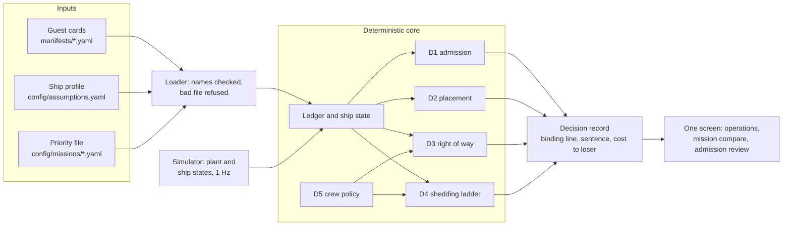

# ArgOS: a resource governor for a re-configurable vessel

Team entry for Fincantieri's **Software Defined Vessel** challenge (Maritime Dual-Use Hackathon, San
Francisco, 16-18 Oct 2026). ArgOS, after the Argo, is the operating system the ship does not have: it owns
the hull's finite physical budget and decides, in seconds and in one plain sentence, which payloads come
aboard, where they go, who wins when two want the same thing, and what is shed when a generator trips.

> **Status (Sat 16:10 PDT): the engine (D1 to D4, the R3 crew rule, the state estimator, the tick loop and replay)
> and the screen run end to end with `uv run sdv demo`. The simulator is a labelled test double until Siddharth's lands.**
> Everything marked *planned* below is design.

## Run it

Works today (Python 3.12 via uv). The tests check the cards and priority
files against their schemas, the data against the brief's arithmetic, the expected outcomes and the
Scenario B timeline against the cards, and every requirement link:

```bash
uv sync
uv run pytest
uv run sdv admit G4 --installed G1,G2,G3 --mission survey
uv run sdv admit G4 --installed G1,G2,G3 --set G4.hangar.mass_t=0.8
uv run sdv admit G7 --card path/to/G7.yaml --installed G4,G5 --mission disaster_relief
uv run sdv run --mission sar --log-dir runs/b-sar && uv run sdv replay runs/b-sar --mission sar
```

`sdv admit` runs D1 and D2 on the real engine: verdict, binding line, every ledger line, placement, ranked
yes-if options and the one-genset-down check, with the time taken against the 30 s ceiling. `--card` admits a
card handed over as a file: a schema or vocabulary problem is refused with the field named (exit 2); a card whose
activities are not yet registered in `config/signals.yaml` is judged on its quantities, positions and relations,
and the output says so. A bad file in `manifests/` is reported once at start and skipped, never fatal. `sdv run` plays
Scenario B through the tick loop (simulator, estimator, decisions) and prints each decision's sentence;
`sdv replay` re-runs the logs without the simulator and checks every snapshot and record byte for byte.
`sdv kit` plans the governor's own computers and builds the Deployment Reference Kit ([deployment](docs/DEPLOYMENT.md)).

`sdv demo` is the one demo command. It starts the decision engine and the screen on http://127.0.0.1:8000 and
plays Scenario B live at x12 (a ship minute every 5 s). Views: Operations, the constraint ledger, Mission compare
(both files on the same inputs), Admission review (Scenario A with the jury's card), the profile and rule builder,
and Reference (every tag, acronym and decision class). The priority file is picked and swapped on screen.
Entry point `sdv.cli:main` (`src/sdv/cli.py`):

```bash
uv run sdv demo
```

## The idea in one line

**One ledger, one manifest language.** Everything that uses or supplies a resource is described the
same way and counted in one ledger of margins across the brief's eight resource classes: power, heat
rejection, deck positions, mast positions, mass and stability, data links, compute and response time.
Every decision names the ledger line that bound it. Host commitments are never shed; guests are
admitted, placed, throttled or shed; supply can degrade; crew are both hands and authority. Details: [GAMEPLAN, Core model](GAMEPLAN.md#core-model-locked-by-logan-fri-2100-pdt).

## Architecture



The inputs exist and are tested; the rest of this section is planned. Card conditions are typed: every
signal, position and capability name is checked against the ship profile, and an unknown name refuses the
file. Faults enter only as debounced, confirmed plant signals: a genset trip on 2 of 3 signals, a cooling
fault on the plant alarm plus flow or delta-T; each record keeps the raw-event and confirmation times. A
stale feed falls to its conservative value, and the sentence says so. Safety commands (stop, hold,
secure; 200 ms, A.8) are answered from a table precomputed every tick, never by a solver. The acoustic
link to the seabed vehicle is up only on a steady course, in quiet, with no deck machinery running, and
is assumed lost the moment one of those fails. A replay reproduces every record field except wall-clock
latency and timestamps, which go to a separate timing log.

The screen is one page with three views: Operations (schematic, eight gauges, decision log, with the
constraint ledger as its drill-down), Mission compare (two runs, one per priority file, on one timeline)
and Admission review (the jury's card). An Arduino VENTUNO Q board ([measured](docs/NODE_B_BOARD.md)) is
an instrument only: it runs the same container and reports watts, latency per decision class and CPU
share against A.7 for the Physical Account; every demo input comes from the laptop. Data contracts:
[docs/ARCHITECTURE.md](docs/ARCHITECTURE.md).

**Prior art.** Ships already shed load: a power management system trips non-essential consumers in a
fixed preferential-trip order when a generator is lost. ArgOS is a mission-aware, explainable version of
that ladder: the order follows the active mission, throttling comes before tripping, and every step names
the line that bound it.

## Decision classes

D1 to D4 read one ledger (`src/sdv/ledger.py`) and write the same
[decision record](docs/ARCHITECTURE.md#data-contracts); ceilings are the brief's (A.8).

| Class (ceiling) | Component | What it optimises |
|---|---|---|
| D1 Admission (30 s) | `src/sdv/admission.py` | A verdict that holds at both gensets, 200 kW and 30 °C, and survives one genset down by throttling (rule below); for yes-if, the least mission value lost |
| D2 Placement (30 s) | `src/sdv/placement.py` | No installed part left without a position; most parts placed; fewest port moves; preferred positions first |
| D3 Right of way (2 s) | `src/sdv/arbitration.py` | Hard limits first (the drone's 12-minute landing rule), then mission-weighted value from the priority file; cost to the loser stated |
| D4 Degradation (5 s, 60 s) | `src/sdv/shedding.py` | By [response class](docs/RESPONSE_TIME.md): 200 MS never shed (safety table), 5 S first, 60 S mission-critical one step a second; throttle before shed in each class, then `shed_order`, then least mission loss per kW; ladder precomputed every tick |
| D5 Crew as a setting | `src/sdv/crew_policy.py` (planned) | Per rule and crew level (14, 6, 0): confirm, standing plan, automatic or forbidden; a priority file may override a level, never to confirm at 0 (A.6); rule R3 in the [Scenario C memo](docs/SCENARIO_C_MEMO.md) |
| D6 Physical Account | `tools/physical_account.py` (built) | Every assumed number, with its reason and where code uses it: [docs/PHYSICAL_ACCOUNT.md](docs/PHYSICAL_ACCOUNT.md) |

**D1 rule.** Judged at both gensets, the 200 kW reserve (A.1) and cooling at 30 °C (A.10); it must also
survive one genset down by throttling to the 95 kW gate, otherwise yes-if, with the raw one-genset-down
line always shown (DEC-35). In port, installed guests may move between bays, each move reported with its
crane time (DEC-37). Links are judged at guests' minimum rates, any nominal shortfall shown as degraded
quality (DEC-38). The seawater tipping point is reported. D1 and D2 search by enumeration: six guests and
six positions, Bay 1 in halves, give a few thousand assignments, so the binding line and the rejected
alternatives come out directly, in milliseconds.

## Deliverables

- **Prototype, one documented command:** `uv run sdv demo` ([Run it](#run-it)), the screen on the live engine.
- **Manifest schema, five cards plus one of ours:** [manifests/schema.json](manifests/schema.json),
  [G1-G6](manifests/) (G6 is our desalination unit), [how to add a card](manifests/README.md); validated by tests.
- **README (at most 3 pages), Physical Account (1 page), Scenario C memo (PDF, at most 2 pages):** this
  file, the [account](docs/PHYSICAL_ACCOUNT.md) (from [config/assumptions.yaml](config/assumptions.yaml) and the cards) and
  the [memo](docs/SCENARIO_C_MEMO.md); `tools/build_pdfs.py` builds each PDF and checks its limit.
- **Live demo, 90 s of Scenario B, then Scenario A with the jury's card:** [storyboard](docs/DEMO_SCRIPT.md),
  planned. Scenario B runs G3, G4 and G5 (DEC-32). Minute 8: D3 decides between the drone (G4) and the
  seabed vehicle (G3) under both priority files. Minute 12: a genset trips; the load (48 kW survey, 81 kW
  rescue) holds under the 95 kW ceiling, and D4 shows both armed ladders, each starting with the comms node
  (G5) to low power, with no step needed. Minute 19: a labelled, injected pump fault makes cooling bind (81
  against 75 kW); D4 slows G4's charge to 10 kW (survey file) or takes G5 to 8 kW (rescue file) (DEC-40).

## Repository map

Every path and what it holds: [docs/REPOSITORY_MAP.md](docs/REPOSITORY_MAP.md). Every requirement, and how we address
it: [docs/REQUIREMENTS.md](docs/REQUIREMENTS.md). Decisions and who made them: [WORKLOG.md](WORKLOG.md).

## Limitations (today)

- The simulator is Siddharth's. Until it lands on main, the loop runs on a labelled test double of it built from
  the contract only ([docs/STATE_ESTIMATION.md](docs/STATE_ESTIMATION.md)); `SDV_SIM=module:Class` swaps in his.
- Numbers come from the brief's annexes and our labelled assumptions, never from a real vessel.
- By choice, both power lines survive a genset trip (A.9); a 40 % cooling loss is information only (DEC-36).
- With nobody aboard, rule R3 trusts a deck latched clear at the last crew sweep; nothing aboard sees
  loose gear shift after that sweep.

## With another week

- Calibrate the simulator's plant and sea models against the public datasets already identified.
- Measure ArgOS under load on hardware closer to A.7's rack, and scale the Physical Account's figures.
- Settle the emission-silence rule with G4 airborne as one D3 rule and show it live.
- Work through more priority files and jury cards, including hostile ones.

## Declarations and licence

AI and software, with licences and origins: [docs/SOFTWARE_LOG.md](docs/SOFTWARE_LOG.md). Claude (Anthropic) is the
coding and research assistant; no model from a China-based company is used. Only open-source third-party
code or our own; code licence [MIT](LICENSE). Data (planned): sea temperature, waves and wind from
Open-Meteo (a source the brief names), cached offline. Weather data by [Open-Meteo.com](https://open-meteo.com/), CC BY 4.0.
