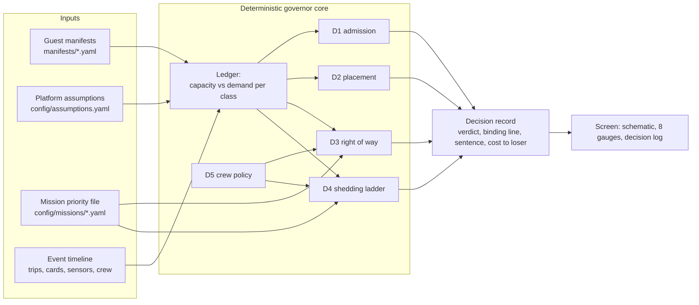

# softwareDefinedVessels: a resource governor for a re-configurable vessel

Team entry for Fincantieri's **Software Defined Vessel** challenge (Maritime Dual-Use Hackathon, San
Francisco, 16-18 Oct 2026). The governor is the middleware the ship does not have: it owns the hull's
finite physical budget and decides, in seconds and in one plain sentence, which payloads come aboard,
where they go, who wins when two want the same thing, and what is shed when a generator trips.

> **Status (Sat 14:30 PDT): engine built and tested against the hand-computed oracles.** D1 to D4, the
> decision record, the priority-file guard, the seeded simulator with the A.6 ship-state machine and the
> `sdv demo` command run end to end on the terminal (479 tests). The screen (D5 view, gauges) is still
> the terminal output; items marked *planned* below are design.

## Run it

Python 3.12 via uv. The tests check the cards and priority files against their schemas, the data against
the brief's arithmetic, and every engine (D1 to D4) against `tests/oracles/expected_outcomes.yaml`:

```bash
uv sync
uv run pytest
```

The one demo command runs 90 s of Scenario B (minutes 0-20) with the real governor under the survey file, replays the
same events under the rescue file and prints both records side by side, then takes the jury's card for
Scenario A (an id, or a YAML file validated against the schema, with live edits such as
`G4.hangar.mass_t=0.8`):

```bash
uv run sdv demo                                     # Scenario B, then an interactive Scenario A prompt
uv run sdv admit G4 --installed G1,G2,G3 --mission sar --edit G4.hangar.mass_t=0.8
uv run sdv sim scenario-b --mission sar             # closed loop, JSONL run file with every decision record
uv run sdv replay-check scenario-b --mission sar    # two runs, decisions included, hashes must match
```

## The idea in one line

**One ledger, one manifest language.** Everything that uses or supplies a resource is described the
same way and counted in one ledger of margins across the brief's eight resource classes: power, heat
rejection, deck positions, mast positions, mass and stability, data links, compute and response time.
Every decision names the ledger line that bound it. Host commitments are never shed; guests are
admitted, placed, throttled or shed; supply can degrade; crew are both hands and authority. Details: [GAMEPLAN, Core model](GAMEPLAN.md#core-model-locked-by-logan-fri-2100-pdt).

## Architecture



Same inputs give the same decisions and sentences: `sdv replay-check` runs twice and the run hashes,
decision records included, match. The board (Arduino VENTUNO Q, [up and measured](docs/NODE_B_BOARD.md))
is an instrument, not a demo dependency (DEC-44). Data contracts: [docs/ARCHITECTURE.md](docs/ARCHITECTURE.md);
plant commands and snapshot: [docs/PLANT_CONTRACT.md](docs/PLANT_CONTRACT.md).

## Decision classes

D1 to D4 read one ledger (`src/sdv/ledger.py`) and write the same
[decision record](docs/ARCHITECTURE.md#data-contracts) (`src/sdv/decision.py`); ceilings are the brief's (A.8)
and every record carries its measured latency against them. The governor (`src/sdv/governor.py`) runs them
inside the simulator's tick.

| Class (ceiling) | Component | What it optimises |
|---|---|---|
| D1 Admission (30 s) | `src/sdv/admission.py` | A verdict that holds at both gensets, 200 kW and 30 °C, and survives one genset down by throttling (rule below); for yes-if, the least mission value lost |
| D2 Placement (30 s) | `src/sdv/placement.py` | Exhaustive enumeration: largest smallest remaining margin; preferred slots first; rejected alternatives named with their reason |
| D3 Right of way (2 s) | `src/sdv/right_of_way.py` | Hard limits first (the drone's 12-minute landing rule), then mission-weighted value from the priority file; cost to the loser stated in its own minutes |
| D4 Degradation (5 s, 60 s) | `src/sdv/shedding.py` | Throttle before shed; least mission loss per kW freed on the binding line, power or cooling (DEC-40), both rechecked each step; safety-critical never shed; ladder precomputed every tick |
| D5 Crew as a setting | `src/sdv/plant/fsm.py` (deck clearing by crew level; the policy table is planned) | What a human confirms, what is automatic, what is forbidden at 14, 6 and 0 aboard; rule R3 in the [Scenario C memo](docs/SCENARIO_C_MEMO.md) |
| D6 Physical Account | `tools/physical_account.py` (built) | Every assumed number, with its reason and where code uses it: [docs/PHYSICAL_ACCOUNT.md](docs/PHYSICAL_ACCOUNT.md) |

**D1 rule.** Judged at both gensets, the 200 kW reserve (A.1) and cooling at 30 °C (A.10); it must also
survive one genset down by throttling to the 95 kW gate, otherwise yes-if, with the raw one-genset-down
line always shown (DEC-35). In port, installed guests may move between bays, each move reported with its
crane time (DEC-37). Links are judged at guests' minimum rates, any nominal shortfall shown as degraded
quality (DEC-38). The seawater tipping point is reported.

## Deliverables

- **Prototype, one documented command:** `uv run sdv demo` ([Run it](#run-it)).
- **Manifest schema, five cards plus one of ours:** [manifests/schema.json](manifests/schema.json),
  [G1-G6](manifests/) (G6 is our desalination unit), [how to add a card](manifests/README.md); validated by tests.
- **README (at most 3 pages), Physical Account (1 page), Scenario C memo (PDF, at most 2 pages):** this
  file, the [account](docs/PHYSICAL_ACCOUNT.md) (from [config/assumptions.yaml](config/assumptions.yaml) and the cards) and
  the [memo](docs/SCENARIO_C_MEMO.md); `tools/build_pdfs.py` builds each PDF and checks its limit.
- **Live demo, 90 s of Scenario B, then Scenario A with the jury's card:** [storyboard](docs/DEMO_SCRIPT.md),
  on the terminal today. Scenario B runs G3, G4 and G5 (DEC-32). Minute 8: D3 decides between the drone (G4) and the
  seabed vehicle (G3) under both priority files. Minute 12: a genset trips; the load (48 or 81 kW) holds
  under the 95 kW ceiling, and D4 shows both armed ladders with no step needed. Minute 19: a labelled,
  added pump fault makes cooling bind (81 against 75 kW); D4 slows G4's charge to 10 kW (survey file) or
  takes G5 to 8 kW (rescue file) (DEC-40).

## Repository map

Every path and what it holds: [docs/REPOSITORY_MAP.md](docs/REPOSITORY_MAP.md). Every requirement, and how we address
it: [docs/REQUIREMENTS.md](docs/REQUIREMENTS.md). Decisions and who made them: [WORKLOG.md](WORKLOG.md).

## Limitations (today)

- No graphical screen yet: the demo is the terminal output of `sdv demo`; edge failover is cut (DEC-44).
- Launch and recovery are scripted plant events (the drone lands at the pinned minute 17); the governor
  decides and commands the ship state, it does not yet fly the drone.
- Numbers come from the brief's annexes and our labelled assumptions, never from a real vessel.
- By choice, both power lines survive a genset trip (A.9); a 40 % cooling loss is information only (DEC-36).
- Cameras are optional (the governor works with none); camera confidence is uncalibrated.

## With another week

- Calibrate the simulator's sensor models against the public datasets already identified.
- Run the governor on two real edge nodes with wired and wireless paths, and measure failover.
- Validate camera equipment checks on real shipboard footage, with exposure-locked cameras.
- Work through more priority files and jury cards, and harden the crew rule compiler.

## Declarations and licence

AI and software, with licences and origins: [docs/SOFTWARE_LOG.md](docs/SOFTWARE_LOG.md). Claude (Anthropic) is the
coding and research assistant; no model from a China-based company is used. Only open-source third-party
code or our own; code licence [MIT](LICENSE). Data (planned): sea temperature, waves and wind from
Open-Meteo (a source the brief names), cached offline. Weather data by [Open-Meteo.com](https://open-meteo.com/), CC BY 4.0.
