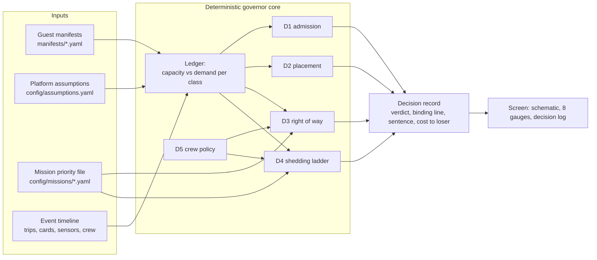

# softwareDefinedVessels: a resource governor for a re-configurable vessel

Team entry for Fincantieri's **Software Defined Vessel** challenge (Maritime Dual-Use Hackathon, San
Francisco, 16-18 Oct 2026). The governor is the middleware the ship does not have: it owns the hull's
finite physical budget and decides, in seconds and in one plain sentence, which payloads come aboard,
where they go, who wins when two want the same thing, and what is shed when a generator trips.

> **Status (Fri 23:56 PDT): planning and data model only.** No decision engine is built yet; the
> team is reviewing the plan before deep implementation. Everything marked *planned* below is design.
> This README is a skeleton for the brief's README deliverable (at most 3 pages).

## Run it

```bash
uv sync
uv run pytest
```

Today this validates the six guest cards against the manifest schema and checks the data against
the brief's own arithmetic, and validates the four priority files, the requirements links and the expected outcomes against the cards (251 tests). The planned one-command demo, with the real decision engine
(the brief forbids mocking it):

```bash
uv run sdv demo scenario-b --priority sar
```

## The idea in one line

**One ledger, one manifest language.** Everything that uses or supplies a resource is described the
same way and counted in one ledger of margins across the brief's eight resource classes: power, heat
rejection, deck positions, mast positions, mass and stability, data links, compute and response time.
Every decision names the ledger line that bound it. Roles differ: host commitments are never shed,
guests are admitted, placed, throttled or shed, supply can degrade, and crew are both hands and
authority. Details: [GAMEPLAN, Core model](GAMEPLAN.md#core-model-locked-by-logan-fri-2100-pdt).

## Architecture



Same inputs give the same decisions and the same sentences, so a standby node takes over by replaying
the event log. Data contracts: [docs/ARCHITECTURE.md](docs/ARCHITECTURE.md).

## Decision classes

| Class | What it optimises | Ceiling | Status |
|---|---|---|---|
| D1 Admission | Feasible across the mission envelope at 30 °C seawater; reports one-genset-down and the seawater tipping point; for yes-if, the least mission value lost | 30 s | planned |
| D2 Placement | Largest smallest remaining margin; preferred slots first; leaves the most future cards admissible | 30 s | planned |
| D3 Right of way | Hard limits first (the drone's 12-minute rule), then mission-weighted value from the active priority file; states the cost to the loser | 2 s | planned |
| D4 Degradation | Throttle before shed; cheapest mission loss per kW first; rechecks power and cooling each step; safety-critical never shed; precomputed every tick | 5 s first, 60 s all | planned |
| D5 Crew as a setting | What a human confirms, what is automatic, what is impossible at 14, 6 and 0 aboard | n/a | [memo drafted](docs/SCENARIO_C_MEMO.md) |
| D6 Physical Account | Every assumed number with its reason and where code uses it | n/a | [draft generated](docs/PHYSICAL_ACCOUNT.md) |

## Deliverables

| Deliverable | Where | Status |
|---|---|---|
| Working prototype, one documented command | `src/sdv/` | planned |
| Manifest schema, five cards plus one of ours | [manifests/schema.json](manifests/schema.json), [G1-G6](manifests/) (G6 is our desalination unit) | drafted, validated by tests, pending team review |
| README, at most 3 pages | this file | skeleton |
| Physical Account | [docs/PHYSICAL_ACCOUNT.md](docs/PHYSICAL_ACCOUNT.md), from [config/assumptions.yaml](config/assumptions.yaml) | draft |
| Scenario C memo, PDF, at most 2 pages | [docs/SCENARIO_C_MEMO.md](docs/SCENARIO_C_MEMO.md), to be exported to PDF for submission | draft for team review |
| Live demo: 90 s of Scenario B, then Scenario A with the jury's card | [demo storyboard](docs/DEMO_SCRIPT.md) | planned |

Every requirement from the brief and slides, and how we address it: [docs/REQUIREMENTS.md](docs/REQUIREMENTS.md).

## Repository map

| Path | What |
|---|---|
| `config/` | Platform assumptions with provenance; mission priority files (survey, rescue, patrol, disaster relief) |
| `manifests/` | Guest manifest schema, the six cards, and [how to add a card](manifests/README.md) |
| `tests/` | Checks that the data reproduces the brief's numbers |
| `tools/` | Physical Account generator |
| `docs/` | Architecture, requirements matrix, Scenario C memo, Physical Account, software and AI log |
| `research/` | Sensors, cameras, Fincantieri vessels, shipboard procedures and accident lessons |
| `GAMEPLAN.md`, `WORKLOG.md` | Plan, schedule, and the team's shared log of decisions and conflicts |

## Limitations (today)

- No decision engine, simulator, screen or edge failover exists yet; all of it is designed, not built.
- Numbers come from the brief's annexes plus our labelled assumptions; nothing is calibrated on a
  real vessel, by design (the brief forbids proprietary vessel data).
- Cameras are optional: the governor must work with none, and camera confidence is uncalibrated.
- The Scenario C memo and the camera design are drafts awaiting team review.

## With another week

- Calibrate the simulator's sensor models against the public datasets already identified.
- Run the governor on two real edge nodes with wired and wireless paths, and measure failover.
- Validate camera equipment checks on real shipboard footage, with exposure-locked cameras.
- Work through more priority files and jury cards, and harden the crew rule compiler.

## Declarations and licence

- AI and software used, with licences and origins: [docs/SOFTWARE_LOG.md](docs/SOFTWARE_LOG.md). Claude
  (Anthropic) is the coding and research assistant; no model from a China-based company is used.
- Only open-source third-party code or our own. Code licence: [MIT](LICENSE).
- Team log of decisions, conflicts and who made them: [WORKLOG.md](WORKLOG.md).
