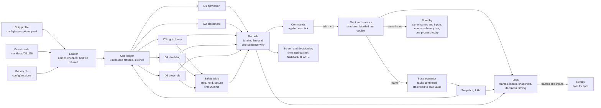

# ArgOS architecture on one page

**ArgOS: Reliability through Automation**

- A general picture of the loop, not a code walk-through.
- Numbers come from [PITCH_FACTS.md](PITCH_FACTS.md) (F-nn rows, X-nn do not claim).
- Written by Claude Opus 5.5 on behalf of Logan Walker (GhostWalka), Sat 2026-10-17 PDT. Refreshed Sun 00:20 PDT against main `4c4f93c`.

Terms:

- **Tick:** one ship second. The loop runs once per tick (1 Hz).
- **Frame:** the raw instrument readings of one tick.
- **Snapshot:** the estimated ship state of one tick, every field with its source and age.
- **Ledger:** capacity, demand and free space per resource line.
- **Record:** one decision, its numbers, and one sentence on why.

## The loop, once per ship second

## The components

| # | Component | Path | What it optimises |
|---|---|---|---|
| 1 | Loader | `src/sdv/loader.py` | no bad file replaces a good one: unknown names refused, the field named (F-64). A new card loads as a file (F-105) |
| 2 | Plant and sensors | `tests/support/sim_stub.py`, a test double. `SDV_SIM` swaps in the real one | the brief's event timeline at 1 Hz, labelled as a double |
| 3 | State estimator | `src/sdv/estimator.py`, `config/signals.yaml` | faults confirmed before anyone acts, a stale feed falls to its safe value. Gap: a dropped guest meter still sheds (X-25). Hardening (on branch fix/review-ours, not on main yet) |
| 4 | Ledger | `src/sdv/ledger.py` | one model for all 8 classes. 1 kW drawn on the chilled-water loop is 1 kW of heat. Air-cooled guests count on power only. Cooling falls as seawater warms |
| 5 | D1 admission | `src/sdv/admission.py` | a verdict that holds at the envelope and one genset down. Yes-if by least value lost |
| 6 | D2 placement | `src/sdv/placement.py` | every installed part placed, fewest moves, preferred positions first |
| 7 | D3 right of way | `src/sdv/arbitration.py` | hard limits first, then the priority file's weights. The loser's cost stated |
| 8 | D4 shedding | `src/sdv/shedding.py` | by response class, slow down before switching off, least mission value lost per kW (changes when fix/scenario-b-loadout-g1 merges: power and cooling judged on their own lines) |
| 9 | D5 crew rule, safety table | `src/sdv/core.py`, `src/sdv/safety.py` | who decides at 14, 6 and 0 aboard. Stop, hold, secure answered by lookup (F-20). No screen control sends one (X-27) |
| 10 | Records and sentences | `src/sdv/records.py`, `src/sdv/explain.py` | one sentence from the binding numbers. No canned strings |
| 11 | Loop, logs, replay, standby | `src/sdv/loop.py` | same inputs, same decisions: replay equal (F-55), standby in step (F-56), every screen run logged (F-109) |
| 12 | Screen, Reference Kit, Physical Account | `src/sdv/ui/`, `src/sdv/kit.py`, `tools/physical_account.py` | one screen for the bridge. The docs aboard (F-77). Every assumed number traced (F-89) |
| 13 | Deployment map | `tools/deploy_map/deploy.py` (on branch feat/deployment-map, not on main yet) | route weather from 1 to 15 Oct 2026 against every profile, offline (F-79 to F-88) |

## Built, and design only

| Built and run tonight | Design only, not built |
|---|---|
| standby in step every tick, in one process (F-56) | automatic takeover by the standby board after 3 s (X-17) |
| 4 boards and 6 edge nodes planned per hull (F-71 to F-74) | edge nodes holding a shed table (X-24) |
| due ticks in every D4 record, NORMAL or LATE on screen (F-104) | MET and MISSED verdicts per step (X-18) |
| kit build, verify, install, rollback (F-77) | kit rebuilt aboard for a guest swapped at sea (X-31) |
